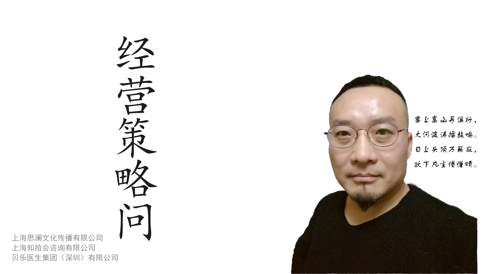
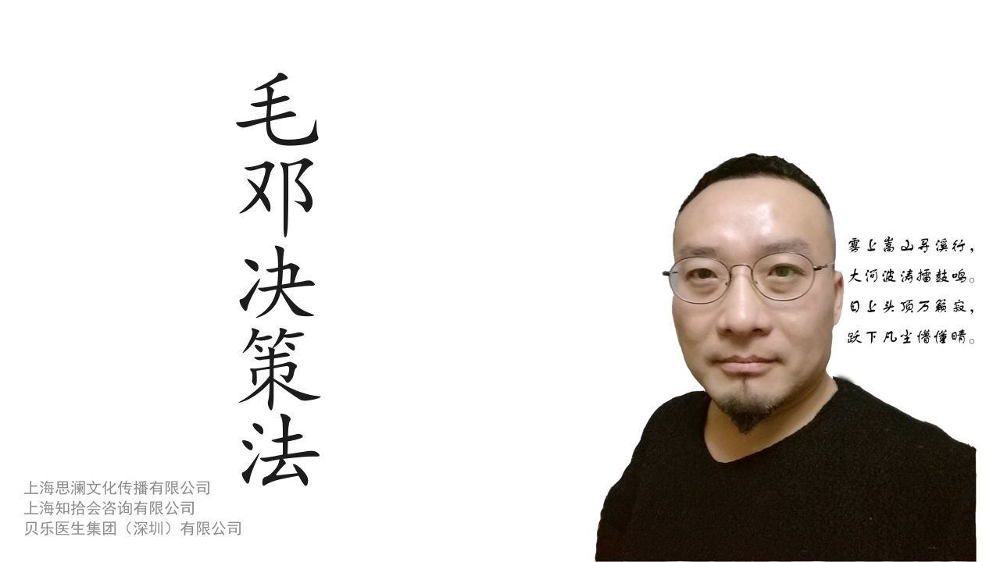
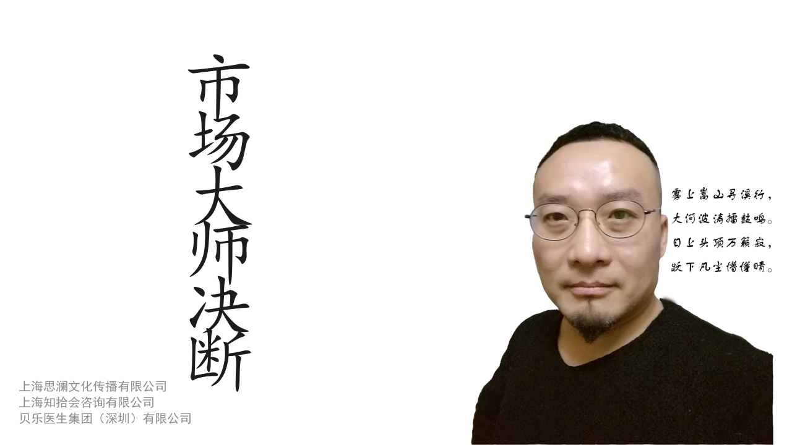

# 经营决策三件套 · Business Decision Skills

一套可安装的 AI Agent 技能包，包含三个可独立使用、也可叠加使用的方法论技能。

| 技能 | 目录 | 定位 |
|---|---|---|
| 经营策略问 | `jingying/` | 11 位管理思想家的经营决策操作系统 |
| 毛邓决策法 | `juece/` | 从毛、邓原典提炼的七步决策法 |
| 市场大师决断 | `shichang/` | 10 位营销大师的市场决策操作系统 |

三者可以叠加使用：决策定大势与中心任务，经营拆生意与组织，市场打认知与转化。

## 封面

<p align="center">
  
  
  
</p>

## 安装

### Codex（本地技能）

把三个目录复制到 Codex 的技能目录：

```powershell
Copy-Item -Recurse .\jingying, .\juece, .\shichang "$env:USERPROFILE\.codex\skills\"
```

重启 Codex 或新开会话后即可使用。

### skills.sh / 一条命令安装

```bash
npx skills add hughmahui/hughmahui
```

只装其中一个：

```bash
npx skills add hughmahui/hughmahui@jingying
npx skills add hughmahui/hughmahui@juece
npx skills add hughmahui/hughmahui@shichang
```

仓库地址：`https://github.com/hughmahui/hughmahui`

## 使用示例

- 经营：`用经营技能分析一下：我们该不该把业务扩张到外地市场？`
- 决策：`这事我拿不定主意，用决策技能帮我拆主要矛盾和中心任务。`
- 市场：`用市场技能分析：我们在价格战里应该怎么定位？`

也可以直接用触发词：`经营分析`、`经营决策`、`战略定位`、`五力分析`、`帮我决策`、`决策框架`、`市场分析`、`定位`、`4P`、`STP` 等。

## 目录结构

```text
.
├── jingying/          # 经营
│   ├── SKILL.md
│   └── references/
├── juece/             # 决策
│   ├── SKILL.md
│   └── references/
├── shichang/          # 市场
│   ├── SKILL.md
│   └── references/
├── assets/            # 封面图
│   ├── cover-jingying.png
│   ├── cover-juece.png
│   └── cover-shichang.png
└── README.md
```

每个 `SKILL.md` 都带 `name`、`description`、`version` 和 `references/` 资料库。

## 作者与出品

- 作者：马辉
- 出品：上海思澜文化传播有限公司、上海知拾会咨询有限公司、贝乐医生集团（深圳）有限公司

## 许可

本项目采用 [Creative Commons Attribution 4.0 International (CC BY 4.0)](https://creativecommons.org/licenses/by/4.0/) 许可。

你可以自由分享、修改，甚至用于商业目的，但必须：

- 注明作者与出处
- 附上许可证链接
- 说明是否做了修改

完整法律文本见 [LICENSE](LICENSE)。

底层引用作品（德鲁克、波特、毛选、邓选、科特勒等）的版权归原作者及出版方所有；本许可仅覆盖本仓库作者原创的提炼、结构与表述。

## 版权说明

技能内容是作者基于公开作品的提炼、评述与结构化整理；原文引用及作品的版权归原作者和出版方所有。公开发布或商用前，请确认引用范围符合平台规则与适用法律。

## English

A bundle of three installable agent skills for business decision-making:

- `jingying` — Business Strategy: an operating system distilled from eleven management thinkers.
- `juece` — Mao–Deng Decision Method: a seven-step decision framework drawn from the original texts.
- `shichang` — Marketing Masters' Judgment: a marketing decision operating system distilled from ten marketing masters.

Install all three with `npx skills add hughmahui/hughmahui`, or one with `npx skills add hughmahui/hughmahui@jingying`.

